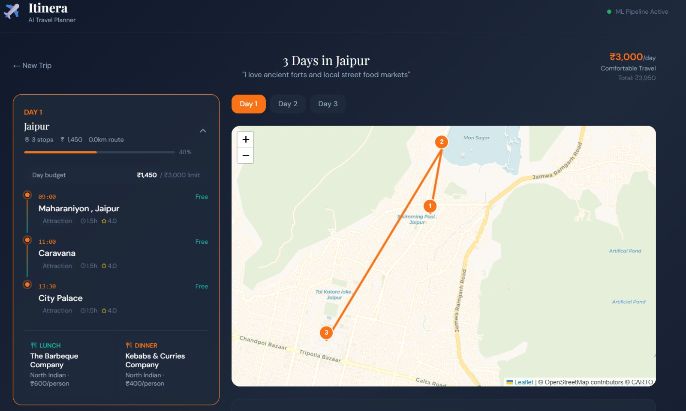
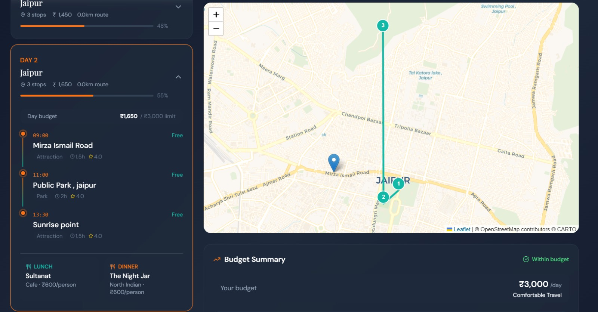
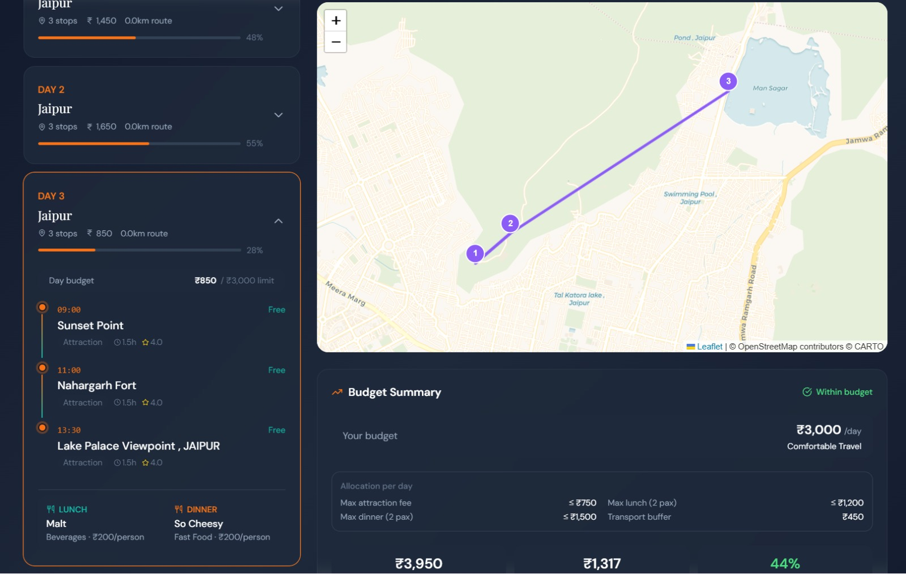
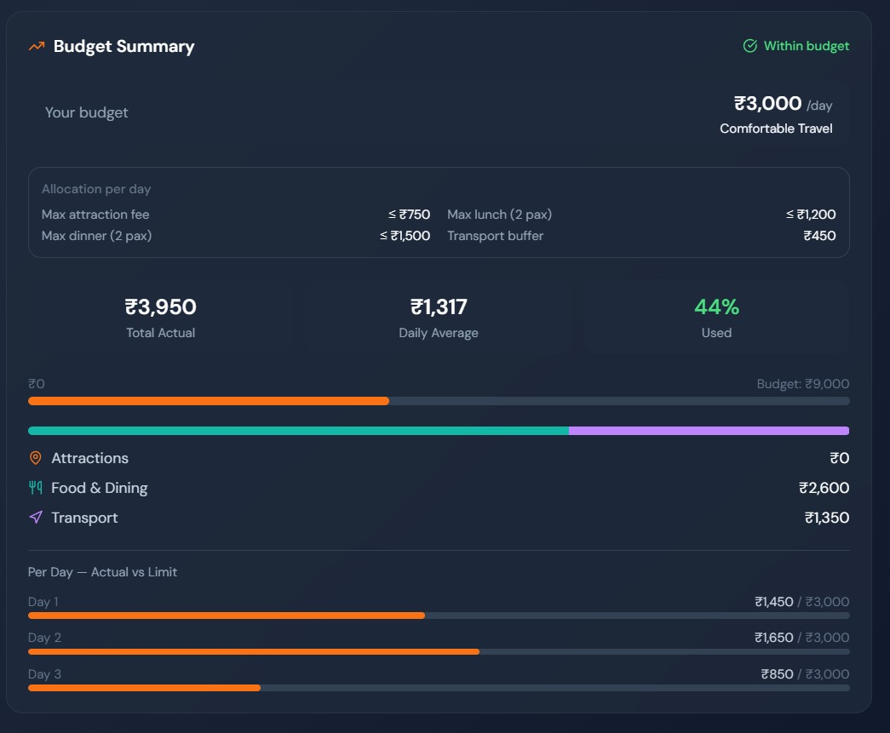

# Itinera – Smart Path for Meaningful Travel

> An AI-powered travel itinerary generator that creates personalized, day-wise travel plans for Indian cities based on natural language preferences and real-world place data.

---

## Project Description

Itinera accepts a city name, number of travel days, daily budget in Indian Rupees, and a free-text description of travel interests. It uses Sentence-BERT to semantically understand the preference description, fetches real tourist attractions from the Geoapify Places API, builds a dynamic FAISS index for similarity search, re-ranks results using a trained XGBoost model, optimizes the daily visit route using Google OR-Tools, and returns a complete day-by-day itinerary with time slots, restaurant recommendations, and a budget breakdown — rendered on an interactive map.

Itineraries are generated in real time and returned directly as API responses. No data is stored between sessions.

---
## Screenshots

### 🏠 Home Page – User Input


Users enter the destination city, trip duration, daily budget, and travel preferences.  
The system also provides smart budget presets and real-time budget breakdown guidance.

---

### 💰 Budget & Preference Input


Interactive budget selection with categorized spending limits for attractions, food, and transport.  
Users can describe their travel style in natural language, which is processed using Sentence-BERT.

---

### 🗺️ Day-wise Itinerary with Map (Day 1)


Generated itinerary for Day 1 with optimized route visualization using Leaflet.  
Includes time slots, attractions, and recommended restaurants with cost estimates.

---

### 📍 Day 2 Route Optimization


AI-optimized route for Day 2 minimizing travel distance using OR-Tools.  
Ensures efficient sequencing of attractions with no repetition.

---

### 🌄 Day 3 Planning


Final day itinerary showcasing balanced scheduling and budget-aware recommendations.  
Maintains variety in attractions and efficient travel flow.

---

### 📊 Budget Summary Dashboard


Comprehensive budget analysis including total spend, daily averages, and category-wise distribution.  
Provides insights into budget utilization and ensures the plan stays within limits.

---

## Features

- Natural language preference understanding using Sentence-BERT
- Live attraction data fetched from Geoapify Places API
- Dynamic FAISS index built per request for semantic similarity search
- Gradient boosting learning-to-rank using XGBoost (pairwise objective)
- Route optimization per day using Google OR-Tools (TSP solver)
- Constraint-based day scheduling with no attraction repeated across days
- Numeric INR budget enforcement at attraction and restaurant level
- Separate lunch and dinner recommendations filtered by city and budget
- Interactive Leaflet map with numbered markers and optimized route polyline
- Per-day budget utilization reporting

---

## Tech Stack

### Backend

| Tool | Purpose |
|---|---|
| FastAPI | REST API server |
| Pydantic | Request and response validation |
| Uvicorn | ASGI server |
| httpx | HTTP client for Geoapify API calls |

### Frontend

| Tool | Purpose |
|---|---|
| React + TypeScript | UI framework with static type checking |
| Vite | Build tool and development server |
| Tailwind CSS | Utility-first styling |
| React Leaflet + Leaflet.js | Interactive map with markers and route polyline |
| TanStack React Query | API call management and loading states |
| Axios | HTTP client |

### Machine Learning

| Tool | Purpose |
|---|---|
| Sentence-BERT (all-MiniLM-L6-v2) | Converts text to 384-dimensional semantic embeddings |
| FAISS (IndexFlatIP) | Dynamic vector similarity search per request |
| XGBoost (XGBRanker) | Pairwise learning-to-rank model |
| Google OR-Tools | Route optimization via TSP solver |
| geopy + Nominatim | City geocoding and distance calculation |

### Data Source

| Source | Purpose |
|---|---|
| Geoapify Places API | Live tourist attractions with GPS coordinates |
| Nominatim (OpenStreetMap) | City name to latitude/longitude geocoding |

---

## Project Structure

```
itinera/
│
├── backend/                        # FastAPI application
│   ├── api/
│   │   └── routes/                 # API route handlers
│   ├── core/
│   │   └── config.py               # Environment-based settings
│   ├── schemas/
│   │   └── itinerary_schema.py     # Pydantic request/response schemas
│   ├── services/
│   │   ├── ml_service.py           # ML pipeline orchestrator
│   │   └── geo_service.py          # Geoapify API integration
│   └── main.py                     # FastAPI app entry point
│
├── ml/                             # Machine learning pipeline
│   ├── recommender/
│   │   └── semantic_search.py      # SBERT encoding + dynamic FAISS search
│   ├── ranking/
│   │   └── train_ranker.py         # XGBRanker training and inference
│   ├── optimizer/
│   │   └── route_optimizer.py      # OR-Tools TSP route optimizer
│   └── scheduler/
│       └── day_scheduler.py        # Constraint-based day planner
│
├── data/
│   ├── processed/                  # Cleaned restaurant data (sample)
│   └── models/                     # Trained XGBoost model artifact
│
├── frontend/                       # React + TypeScript frontend
│   ├── src/
│   │   ├── components/
│   │   │   ├── TripForm.tsx        # User input form
│   │   │   ├── ItineraryCard.tsx   # Day card with attraction timeline
│   │   │   ├── ItineraryMap.tsx    # Leaflet map with markers and route
│   │   │   └── BudgetPanel.tsx     # Budget breakdown display
│   │   ├── api/
│   │   │   └── itineraApi.ts       # Axios API client
│   │   ├── types/
│   │   │   └── index.ts            # TypeScript interfaces
│   │   ├── App.tsx
│   │   └── index.css
│   ├── index.html
│   ├── package.json
│   ├── tailwind.config.js
│   ├── tsconfig.json
│   └── vite.config.ts
│
├── requirements.txt
├── .env.example
└── README.md
```

---

## How It Works

```
User Input
  city, days, budget, preference text
          │
          ▼
NLP Preprocessing
  Basic text preprocessing
          │
          ▼
Sentence-BERT Encoding
  Preference text → 384-dimensional embedding vector
          │
          ▼
Geoapify Places API
  Fetch attractions near the selected city
  Validate coordinates, remove duplicates
          │
          ▼
Dynamic FAISS Index
  Encode all places with SBERT
  Build IndexFlatIP in memory for this request
  Search top-K most similar places to user query
          │
          ▼
Budget Filter
  Remove attractions that exceed budget threshold
          │
          ▼
XGBoost Learning-to-Rank
  Re-rank by rating, popularity, and budget fit
  Uses pairwise objective (rank:pairwise)
          │
          ▼
Constraint-Based Scheduler
  Distribute attractions across days
  No attraction repeated (global tracking set)
  Handles limited data with fallback logic
          │
          ▼
OR-Tools Route Optimization
  Solve TSP per day to minimize travel distance
  Reorder attractions for efficient routing
          │
          ▼
Time Slot Assignment
  Assign time slots for each day
  Include meal breaks
          │
          ▼
Restaurant Selection
  Pick lunch and dinner separately
  Filtered by city, budget, no repetition
          │
          ▼
JSON Response
  Returned to React frontend
  Leaflet renders markers and route polyline
```

---

## Example Input

```json
{
  "city": "Jaipur",
  "duration_days": 3,
  "budget_per_day_inr": 3000,
  "preference_text": "I love ancient forts and local street food"
}
```

---

## Environment Setup

Copy the environment template and fill in your values:

```bash
cp .env.example .env
```

Open `.env` and set:

```
GEOAPIFY_API_KEY=your_api_key_here
USE_GEOAPIFY=true
```

Get a free Geoapify API key at: https://myprojects.geoapify.com

Free tier allows 3,000 requests per day — sufficient for development and demo.

---

## Running the Project

> **Note:** Commands below are written for **Linux and WSL (Windows Subsystem for Linux)**.
> On Windows PowerShell, replace `source venv/bin/activate` with `.\venv\Scripts\Activate.ps1`.

### Start the Backend

```bash
cd itinera
source venv/bin/activate
uvicorn backend.main:app --reload
```

- API base URL: `http://localhost:8000`
- Interactive API docs: `http://localhost:8000/docs`

### Start the Frontend

```bash
cd frontend
npm run dev
```

- Frontend URL: `http://localhost:5173`

---

## ML Pipeline

### SBERT Model

The `all-MiniLM-L6-v2` model downloads automatically from HuggingFace on first run (approximately 80MB). No manual download is required.

### FAISS Index

The FAISS index is built dynamically per request from Geoapify data. No prebuilt index file is needed when `USE_GEOAPIFY=true`.

### XGBoost Ranker

Train the ranking model by running:

```bash
source venv/bin/activate
python ml/ranking/train_ranker.py
```

This saves `data/models/xgb_ranker.pkl` which is loaded automatically at API startup. Training takes approximately one to two minutes on a standard machine.

---

## API Endpoints

| Method | Endpoint | Description |
|---|---|---|
| POST | `/api/v1/itinerary/generate` | Generate a day-wise itinerary |
| GET | `/api/v1/cities/search?q=` | City name autocomplete |
| GET | `/api/v1/cities/popular` | List popular tourist cities |

---

## Future Improvements

- Persistent itinerary storage using PostgreSQL and SQLAlchemy
- Background task processing with Redis and Celery
- User authentication and saved itinerary history
- Docker containerization for one-command deployment
- Real-time restaurant data from a live API
- User feedback loop for improving XGBoost ranking
- Support for cities outside India
- Export itinerary as PDF

---