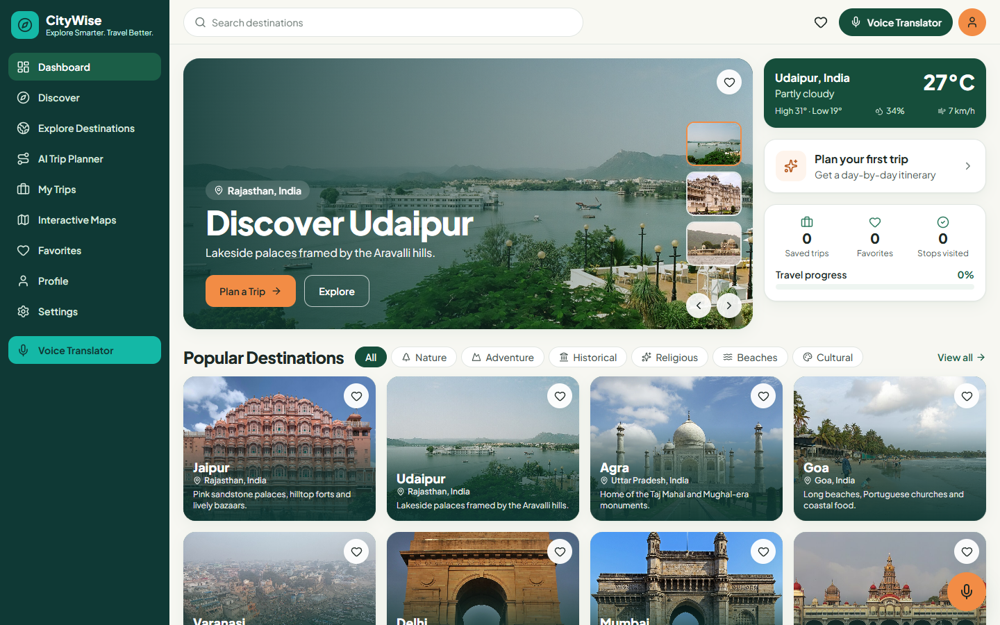
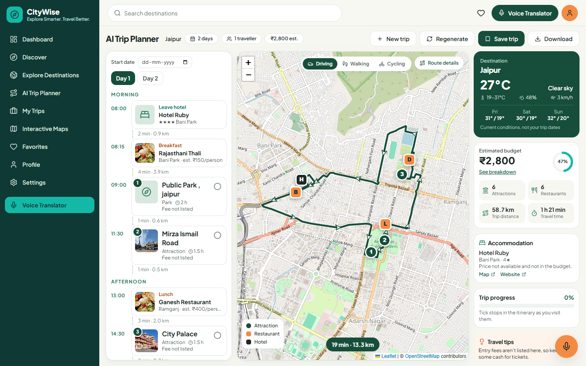
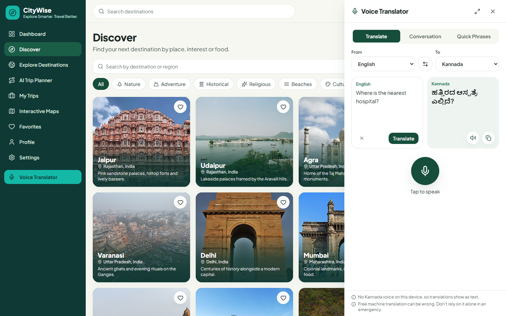
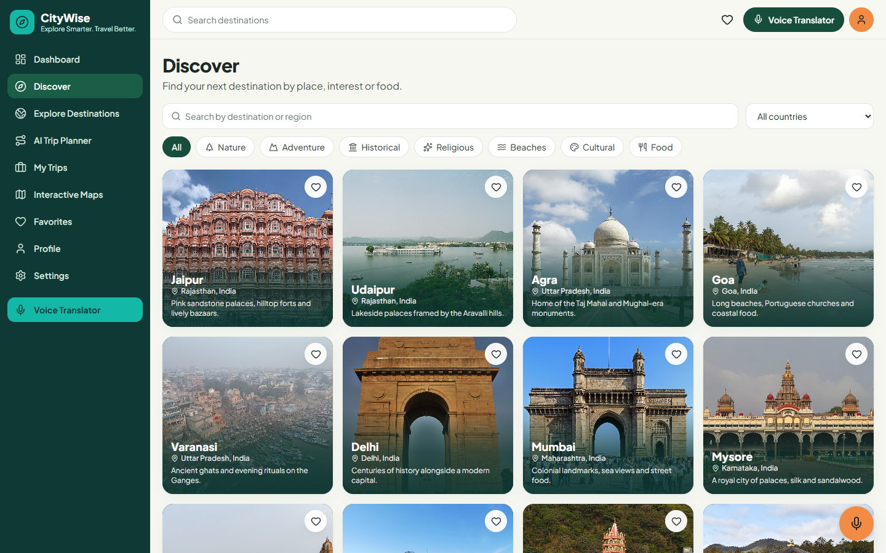
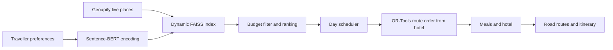

<div align="center">

# 🧭 CityWise

### Explore Smarter. Travel Better.

**An AI-powered travel companion that turns a sentence about your ideal trip into a real, day-by-day plan with road routes, restaurants, hotels and voice translation.**




</div>

## Overview

Planning a trip usually means juggling maps, review sites, budgets and translation apps. CityWise brings them together in one place.

Describe your trip in your own words, such as *"I love ancient forts and local street food"*. CityWise understands what you mean, finds real places in your destination, and builds a complete plan for each day. It starts at your hotel, moves through attractions and meals in a sensible order, and follows real roads back again.

## Key Features

### 🧠 AI Trip Planner

- Understands natural language preferences with Sentence-BERT semantic search
- Builds a FAISS similarity index for each request from live place data
- Supports XGBoost learning-to-rank re-ranking of candidate places
- Plans trips of 1 to 14 days around a daily budget in Indian Rupees
- Regenerates a different plan without repeating the same places

### 🗺️ Three-Panel Trip Workspace

Itinerary, interactive map and trip information stay open side by side and update together.



- **Full day routine:** hotel, breakfast, attractions, lunch, dinner and the return, in time order
- **Road-based routes:** driving, walking and cycling, with direction arrows
- **Smart ordering:** Google OR-Tools plans each day as a round trip from the hotel, starting at the nearer end
- **Linked interactions:** select a stop in the itinerary and its marker highlights on the map, and the other way round
- **Editable plans:** reorder, add or remove stops, and times, costs and routes update automatically

### 🎙️ Voice Translator

One translator panel, available from anywhere in the app without leaving your current page.



- **11 languages:** English, Kannada, Hindi, Tamil, Telugu, Malayalam, Spanish, French, German, Japanese and Korean
- **Translate:** speak or type, then listen to or copy the result
- **Conversation:** a two-person mode with separate speakers and start, pause, resume and stop controls
- **Quick Phrases:** searchable phrases for directions, food, hotels, transport, shopping and emergencies

### 🌍 Discover and Explore



- Browse destinations by country, interest and local food
- Search live places in a city, with list and map views
- See real photos matched to each place
- Check live weather and a three-day forecast

### 💼 Trips and Favorites

- Save, rename, date, download and delete trips
- Track progress by ticking off stops as you visit them
- Keep favorite destinations and places
- Review a budget breakdown by category and by day

## How It Works



1. **Understand:** the preference text is converted into a 384-dimensional embedding.
2. **Discover:** real places are fetched for the destination, and duplicates and map errors are removed.
3. **Match:** FAISS finds the places closest in meaning to the request.
4. **Rank:** candidates are scored on relevance, popularity and budget fit.
5. **Schedule:** places are shared across the days with time slots, and none are repeated.
6. **Optimize:** OR-Tools orders each day around the hotel.
7. **Complete:** nearby restaurants are added, and road routes are drawn on the map.

## Tech Stack

| Layer | Technologies |
| --- | --- |
| **Frontend** | React 19, TypeScript, Vite, Tailwind CSS, React Router, TanStack Query, Axios, Lucide Icons |
| **Maps** | Leaflet, React Leaflet, OpenStreetMap |
| **Backend** | FastAPI, Pydantic, Uvicorn, httpx |
| **AI and ML** | Sentence-Transformers (all-MiniLM-L6-v2), FAISS, XGBoost, scikit-learn, pandas, NumPy |
| **Optimization** | Google OR-Tools, geopy |
| **Speech** | Web Speech API for speech recognition and speech synthesis |
| **Deployment** | Docker, Docker Compose, Nginx |

## External Services

| Service | Used for |
| --- | --- |
| [Geoapify](https://www.geoapify.com/) | Places, restaurants, hotels, road routing and backup geocoding |
| [Nominatim](https://nominatim.org/) | City geocoding |
| [Open-Meteo](https://open-meteo.com/) | Current weather and forecasts |
| [Wikipedia](https://www.wikipedia.org/) and [Wikimedia Commons](https://commons.wikimedia.org/) | Destination, attraction and food photos |
| [MyMemory](https://mymemory.translated.net/) | Translation, with optional Google Cloud Translation support |

API keys stay on the backend and are never exposed to the browser.

## API Overview

| Method | Endpoint | Purpose |
| --- | --- | --- |
| `POST` | `/api/v1/itinerary/generate` | Generate a personalized itinerary |
| `GET` | `/api/v1/attractions/explore` | Search live places by city and interest |
| `GET` | `/api/v1/cities/search` | City autocomplete |
| `POST` | `/api/v1/routing/route` | Road route through a day's stops |
| `GET` | `/api/v1/weather/current` | Current weather and forecast |
| `GET` | `/api/v1/media/photo` | Find a verified photo for a place |
| `POST` | `/api/v1/translate` | Translate text |

## Project Structure

```text
CityWise/
├── backend/          # FastAPI app: routes, schemas and services
│   ├── api/routes/   # Itinerary, explore, routing, weather, media, translate
│   ├── core/         # Configuration and database setup
│   ├── schemas/      # Request and response models
│   └── services/     # ML, geo, translation and HTTP services
├── frontend/         # React and TypeScript app
│   └── src/
│       ├── components/  # Map, itinerary, translator and shared UI
│       ├── context/     # Trip, profile and translator state
│       ├── lib/         # Routes, speech, trip editing and formatting
│       └── pages/       # Dashboard, Discover, Explore, Trips and more
├── ml/               # Machine learning pipeline
│   ├── data_prep/    # Cleaning and feature engineering
│   ├── embeddings/   # SBERT embeddings and FAISS indexes
│   ├── ranking/      # XGBoost ranker
│   ├── recommender/  # Semantic and restaurant recommendation
│   ├── optimizer/    # OR-Tools route optimization
│   └── scheduler/    # Day-by-day scheduling
├── workers/          # Celery background tasks
├── docker/           # Dockerfiles and Nginx configuration
└── screenshots/      # Application screenshots
```

## Design Principles

- **Real data only:** ratings, fees and prices are shown only when they are known, and estimates are clearly labelled.
- **Honest failures:** if a route, translation or speech feature is unavailable, the app says so instead of faking a result.
- **Accurate images:** a photo appears only when it matches the place. Food photos are labelled as typical dishes.
- **Everything within reach:** navigation, trip panels and the translator stay easy to access.

## Current Limitations

- Trips, favorites and profile details are stored in the browser, and there is no user login yet.
- Hotel prices and most restaurant ratings are not available from the current data sources.
- Meal costs are estimates, and accommodation is not included in budget totals.
- Coverage is strongest for India, and data quality is lower for international destinations.
- Machine translations can be inaccurate and should not be relied on alone in emergencies.
- Voice features depend on browser support and the voices installed on the device.

## Roadmap

- [ ] User accounts with cloud-synced trips
- [ ] Verified ratings, reviews and hotel pricing
- [ ] Live traffic for travel times
- [ ] Offline access to saved itineraries
- [ ] Shared trips for group travel

## Acknowledgements

Map data © [OpenStreetMap](https://www.openstreetmap.org/copyright) contributors. Photos come from Wikipedia and Wikimedia Commons and remain under their original licences.

<div align="center">

**CityWise: Explore Smarter. Travel Better.** 🧭

</div>
